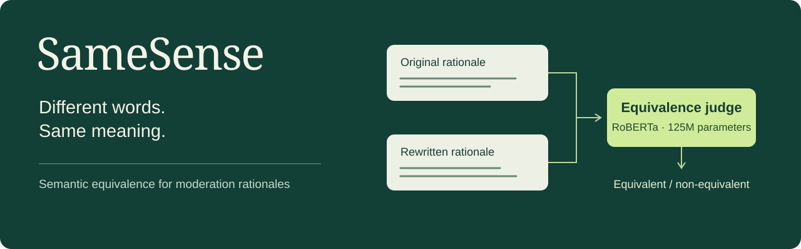

<p align="center">
  
</p>

# SameSense

**A lightweight NLP pipeline for checking whether two moderation rationales say the same thing.**

[](https://github.com/ri-ru/samesense/actions/workflows/checks.yml)
[](code/judge_training/)
[](requirements.txt)

[Build summary](#what-we-built) · [Quick start](#quick-start) · [Validation](guides/validation.md) · [Implementation walkthrough](summary_notebook.ipynb)

## The idea

Two explanations can use different words and still make the same claim. They can also look almost identical while disagreeing on the one detail that matters. SameSense turns that distinction into a sentence-pair classification task: **equivalent** or **non-equivalent**.

The implementation uses a fine-tuned, 125M-parameter RoBERTa encoder rather than calling a large language model for every comparison. It is built around hate-speech moderation rationales: comparing explanations, not deciding whether a post is hateful.

## What we built

- **Data pipeline.** Generated 52,137 labelled rationale pairs from HateCoT source data, with few-shot demonstrations and quality checks.
- **Trainable judge.** Implemented configurable RoBERTa fine-tuning, domain-based evaluation splits, per-domain metrics, and prediction exports.
- **Failure analysis.** Checked performance against lexical and LLM baselines, inspected negation shortcuts, and probed representations layer by layer.
- **Better training data.** Built a five-generator dataset of 998 usable pairs and evaluated the resulting judge on human-written and cross-model explanations.
- **Inspectable delivery.** Included the source datasets, training configurations, evaluation artifacts, seed-sweep results, and a notebook explaining the implementation.

The practical lesson from the build: a strong score on familiar synthetic text did not guarantee reliable behaviour on unfamiliar writing styles. A more varied training set improved the recorded checks.

## Quick start

**Inspect the completed work without a GPU, API key, or dependency install.**

```bash
git clone https://github.com/ri-ru/samesense.git
cd samesense
python3 scripts/project_summary.py
```

This reads the committed artifacts and prints the dataset inventory and model comparison. It does **not** run inference or retrain a model. For machine-readable output, add `--json`.

To follow the code and figures, open [the implementation notebook](summary_notebook.ipynb) directly on GitHub. To train a new judge or rebuild the notebook's cached-result tables, use the [running guide](guides/usage.md).

## Recorded performance

Accuracy of the original single-generator judge and the later multi-generator version:

| Evaluation set | Examples | Single-generator | Multi-generator |
|---|---:|---:|---:|
| Human-written rationales | 20 | 55% | **95%** |
| Claude-written rationales | 20 | 65% | **85%** |
| GPT-4o-mini rationales | 50 | 54% | **72%** |
| Claude Haiku rationales | 100 | 59% | **81%** |

These are recorded runs, and the small human/Claude sets do not establish broad reliability. The [validation notes](guides/validation.md) identify the source artifacts, evaluation boundaries, and known limitations.

## Inside the repository

| Location | What you will find |
|---|---|
| [summary_notebook.ipynb](summary_notebook.ipynb) | Implementation narrative, code excerpts, tables, and figures |
| [code/judge_training/](code/judge_training/) | Data loading, domain splits, tokenization, metrics, and fine-tuning |
| [code/generator_diversity/](code/generator_diversity/) | Multi-model pair generation and comparison scripts |
| [code/interpretability/](code/interpretability/) | Activation extraction, layer-wise probes, and shortcut analysis |
| [code/verify/](code/verify/) | Baseline, domain-shift, and negation checks |
| [configs/](configs/) | Full and smoke-test training configurations |
| [data/](data/) · [results/](results/) · [seeds/](seeds/) | Source data, cached outputs, and repeated-seed checks |

The repository includes code, data, and saved evaluation results. **Trained model weights are not bundled**, and some historical analysis scripts still expect the original cluster layout; the running guide distinguishes supported local entry points from those scripts.

---

Built by **Veronika Wannack, Flavia Wallenhorst, and Dimitri Pelgrin** at EPFL. Originally completed for EE-559 Deep Learning, Group 26. The original project and authorship are preserved in the notebook.
